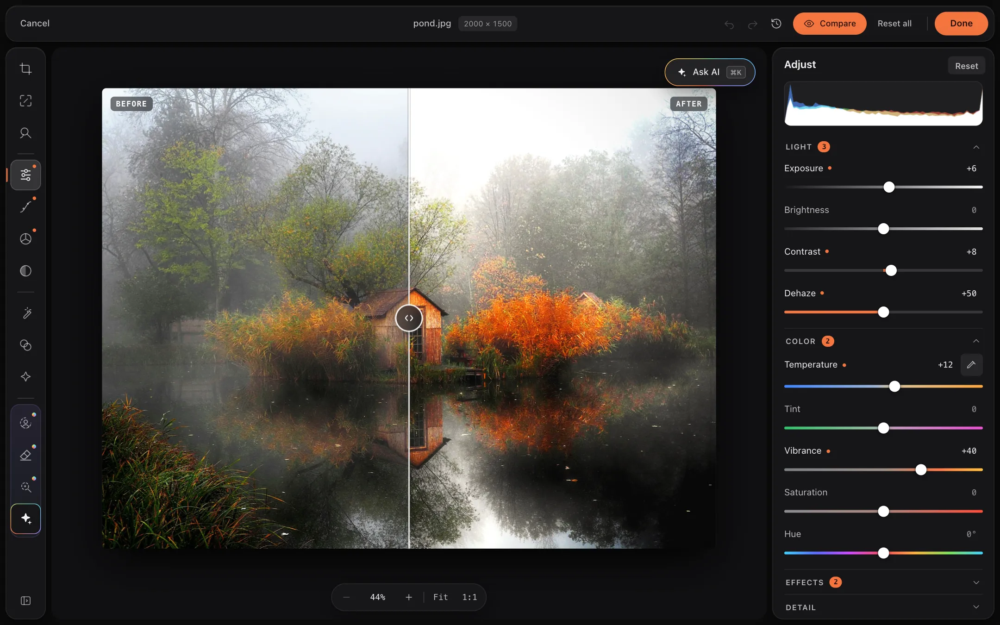
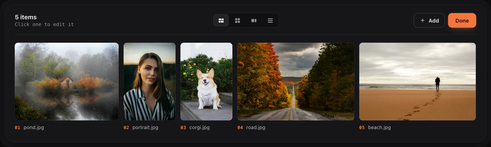
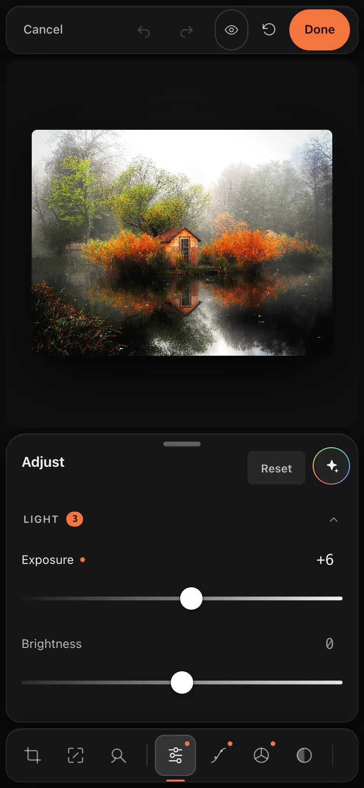
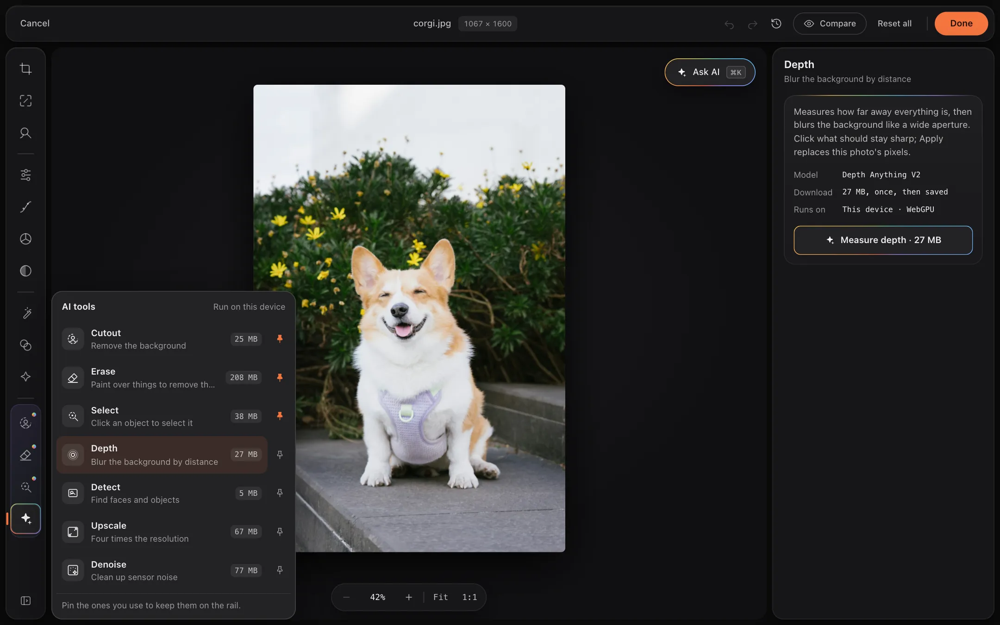

<p align="center">
  <br />
  <picture>
    <source media="(prefers-color-scheme: dark)" srcset=".github/retouch-logo-dark.svg" />
    <source media="(prefers-color-scheme: light)" srcset=".github/retouch-logo-light.svg" />
    
  </picture>
  <br />
</p>

<h3 align="center">
  A drop-in image editor that feels like part of your app.
</h3>

<p align="center">
  Drop files, browse, click to edit — three states, one component.<br/>
  Powered by fabric.js. Canvas-native. Framework-agnostic. Video and on-device ML included.
</p>

<p align="center">
  <a href="https://www.npmjs.com/package/@9tensor/retouch"></a>
  <a href="https://github.com/9tensorsoftware/retouch/blob/main/LICENSE"></a>
  <a href="https://www.npmjs.com/package/@9tensor/retouch"></a>
</p>

<p align="center">
  <a href="https://retouch.9tensor.com">Live Demo</a> &nbsp;·&nbsp;
  <a href="#install">Install</a> &nbsp;·&nbsp;
  <a href="#quick-start">Quick Start</a> &nbsp;·&nbsp;
  <a href="#how-it-works">How It Works</a> &nbsp;·&nbsp;
  <a href="#tools">Tools</a> &nbsp;·&nbsp;
  <a href="#api">API</a> &nbsp;·&nbsp;
  <a href="#development">Development</a>
</p>

<p align="center">
  
</p>

<br />

---

## Why Rétouch?

Most image editors bolt onto your app like an afterthought. Rétouch was designed the other way around — to feel native from day one. No iframes, no external services. Built on [fabric.js](http://fabricjs.com/) for robust canvas rendering, with a clean API that does exactly what your users expect.

- **Powered by fabric.js** — battle-tested canvas engine under the hood, tree-shakeable
- **Three-state UX** — drop zone, gallery, editor — all handled for you
- **Canvas-native** — all processing happens on an HTML Canvas, no server round-trips
- **Video too** — trim, crop, adjust and filter videos, re-encoded in the browser via WebCodecs ([mediabunny](https://mediabunny.dev/) loads lazily, only when a video is exported)
- **On-device ML** — background removal, upscaling, object erase, click-to-select, depth bokeh, denoise via the optional [`@9tensor/retouch-ml`](packages/ml) package; no server, no keys
- **Framework-agnostic** — a vanilla TypeScript class you mount into any element (framework wrappers are on the roadmap)

<br />

## Install

```bash
npm install @9tensor/retouch
```

```bash
pnpm add @9tensor/retouch
```

```bash
yarn add @9tensor/retouch
```

Requirements: a browser with `<canvas>`; ESM-first with a CommonJS build (the CJS bundle still loads
mediabunny/gifenc through `import()`). Importing is side-effect free — styles inject when the first
`Retouch` is constructed — so the package is safe to import under SSR; construct it once a DOM exists
(`useEffect`, `onMount`, …).

<br />

## Quick Start

```ts
import { Retouch } from "@9tensor/retouch";

const retouch = new Retouch({
  target: "#editor",
  onDone: (blobs) => upload(blobs), // edited files, one Blob per entry
});

// When you're finished with it:
retouch.destroy();
```

Users drop files, edit, and press **Done** in the gallery; `onDone` receives every entry exported
with its edits applied (images as PNG by default, videos as MP4/WebM). Hosts can drive the same flow
programmatically — `addFiles()`, `openEditor()`, `done()` — see [API](#api).

<br />

## How It Works

Rétouch lives in **three states**. No complex routing, no page transitions — just one component that adapts.

```
┌─────────────┐      ┌─────────────┐      ┌─────────────┐      ┌──────┐
│  Drop Zone  │ ───→ │   Gallery   │ ───→ │   Editor    │ ───→ │ Done │
│             │      │             │      │             │      │      │
│ Drop, pick  │      │ Contact     │      │ Crop, adjust│      │ Blob │
│ or paste    │      │ sheet       │      │ filter, trim│      │ each │
└─────────────┘      └─────────────┘      └─────────────┘      └──────┘
```

### 1. Drop Zone

The initial state: a small stack of prints that fans out as files are dragged
over, the formats that work, and two ways in besides dropping — **Choose files**
and **Paste** (or ⌘/Ctrl+V anywhere on the page while nothing else has focus;
the button asks the browser to read the clipboard). It hands over to the
gallery the moment files land.

> PNG, JPG, WebP by default, plus MP4, WebM and MOV when video is enabled (it is unless you pass
> `acceptedVideoTypes: []`). Files are unlimited in size and count unless you set `maxFileSize` /
> `maxFiles`. Rejections surface as one toast per batch, saying what would have worked ("Use JPG,
> PNG, WebP, MP4, WebM or MOV."), and a `file:rejected` event per file.

### 2. Gallery

A contact sheet: frames at their true aspect ratios in justified rows, numbered
along the edge, with an **Edited** badge on what's been worked on and the length
on videos. Switch to a square **grid**, a **filmstrip** or a **list**; the choice is
remembered in the browser. Click a frame to edit it. Select frames with the
circle (or ⌘/Ctrl-click, Shift to extend, ⌘/Ctrl+A for all, Esc to clear) to
download or remove them together; on touch screens the circles stay up and
every target is 44 px. Removing offers **Undo** in a toast. Drop, pick or paste to
add more anytime, and press **Done** (shown when `onDone` is configured) to
export everything: long runs show an export sheet with every file's thumbnail,
a ring filling as it exports, and the time left.

<p align="center">
  
</p>

### 3. Editor

Opens as a modal overlay: a neutral graphite stage that keeps focus — and color judgment — on the image, with floating panels around it. The tool rail down the left edge groups tools by job (frame, tone, looks, then plugins), with the AI tools gathered behind one ✦ launcher; the inspector on the right holds the active tool's controls — sliders whose tracks show what they do, preview tiles drawn from your photo — and a live RGB histogram. Zoom up to 800%, pan around the stage, and drag a before/after divider across the photo to compare. On phones, narrow windows and upright tablets the panels stack: the stage on top, the controls in a bottom sheet you drag between its header, half and most of the screen (or fold away by tapping the active tool again), and the tools in a row along the bottom edge to swipe through — every tool works one-handed at 375 × 667. Pinch to zoom, pan with two fingers (or one, once zoomed), and double-tap to zoom in or back to fit. Touch targets are 44 px, and the editor keeps clear of notches and the home indicator when the host page uses `viewport-fit=cover`. A phone on its side keeps the three columns. Opening a photo zooms it from its gallery frame onto the stage, and Done or Cancel settles it back (a view transition; browsers without them cross-fade), while the panels slide in from their edges. With reduced motion asked for, all of it is off and the views simply swap. Tools are pluggable via `Retouch.registerTool`. Everything is non-destructive until you hit **Done**.

<p align="center">
  
</p>

<br />

## Tools

| Tool | Description |
|------|-------------|
| **Crop** | Drag the frame over a rule-of-thirds grid, free or locked to an aspect tile (square, 4:3, 3:2, 16:9, 9:16), then press **Apply** (or Enter); **Cancel** (or Esc) puts the frame back. Nothing is cropped until it's applied: leaving Crop, or pressing Done, with a frame that wasn't applied asks whether to apply it or discard it. The inspector's **Reset** brings the full frame back. A **straighten ruler** (drag it, or use the arrow keys) and rotate/flip buttons sit right in the pane. Works on video too. |
| **Transform** | Rotate 90° and flip H/V that keep the crop over your content, a straighten slider (0.1° steps) that auto-crops to the largest inscribed window (no black corners), vertical/horizontal **perspective (keystone) correction**, **lens corrections** — barrel/pincushion distortion and corner devignetting — and **content-aware width** (seam carving in a worker, images only). |
| **Liquify** | Brush-based push warp: drag on the image to bend and reshape content under a **brush ring** sized to the brush (`[` and `]` resize it), with size and strength controls. Displacements live in a coarse grid in the edit model, so strokes preview live, undo cleanly, and apply to image and video exports alike. |
| **Adjust** | All 14 controls at once, in four folding sections — **Light** (exposure, brightness, contrast, dehaze), **Color** (temperature, tint, vibrance, saturation, hue), **Effects** (clarity, vignette, grain) and **Detail** (sharpen, blur) — real-time, live on playing video. Color sliders show what they do on their tracks (cool to warm, green to magenta, around the hue wheel). Includes a **white-balance eyedropper**: click a neutral area and temperature/tint correct themselves. |
| **Curves** | Photoshop-style tone curves across the inspector's full width: master + per-channel (R/G/B) with draggable control points over a **live histogram**, the other channels' curves drawn faintly, and an input → output readout. Monotone-cubic interpolation (no overshoot), applied identically in the preview, image export, and per-frame video export. |
| **Color mix** | Lightroom-style **HSL mixer**: pick one of eight hue bands (red → magenta) from its swatch, then shift its hue, saturation and luminance on sliders drawn in that band's color, with smooth falloff to neighboring bands. Grays stay untouched. The AI understands it too — "make the sky bluer" targets just the blue band. |
| **Masks** | Selective adjustments: add **linear or radial gradient masks** to a list, drag their handles on the canvas, and dial local exposure/brightness/contrast/saturation/temperature/tint that apply only inside the feathered gradient. Invert or delete each from its row; stackable, fully non-destructive. |
| **Stylize** | Parametric effects, picked from preview tiles drawn from your photo: **tilt-shift** (miniature look with a movable focus band), **duotone** (pick shadow/highlight colors), **posterize**, **pixelate**, **halftone** — each with a strength slider, applied identically at export. |
| **Filters** | 11 presets — B&W, Sepia, Warm, Cool, Vivid, Vintage, Kodachrome, Technicolor, Polaroid, Brownie, Invert — plus Original, as preview tiles drawn from your photo, with an intensity slider. |
| **Trim** | Video only. Filmstrip timeline with draggable in/out handles, loop-in-range preview, keyboard nudging (0.1 s, Shift for 1 s), and playback speed in nine steps from 0.25× to 4×. |
| **Draw** | _Planned._ Freehand drawing and annotation directly on the canvas. |
| **Text** | _Planned._ Add and position text overlays with font and color controls. |
| **Sticker** | _Planned._ Place image overlays and shapes onto the canvas. |

### Video

Drop an MP4, WebM, or MOV alongside your images. Videos get poster cards with a
duration badge in the gallery and open in the same editor with a playback
transport. Everything is non-destructive until export:

- **Trim** — sample-accurate in/out points; an export with no trim, no visual edits and 1× speed copies packets without re-encoding; anything else re-encodes
- **Crop / rotate / adjust / filter** — applied per frame at export, matching the live preview exactly
- **Frame capture** — grab any frame as a new image entry, carrying the video's edits
- **Audio** — preserved through export; one-tap mute discards the track
- **Export** — MP4 (WebM fallback) via WebCodecs + lazily-loaded [mediabunny](https://mediabunny.dev/); browsers without WebCodecs fall back to a realtime MediaRecorder pipeline
- **GIF of the trimmed range** — forward, reverse, or boomerang loops with every edit applied ([gifenc](https://github.com/mattdesl/gifenc) loads lazily); **deflicker** smooths brightness on export; **Set poster** picks the gallery thumbnail frame
- Progress is reported per file (`export:progress` events) with cancellation via `cancelExport()`

### ML tools (`@9tensor/retouch-ml`)

On-device background removal, 4× super-resolution, an object-erase heal
brush, face and object detection (labeled COCO boxes, masks, privacy
pixelate, crop-to-subject), **click-to-select** — click any object to
segment it, then cut it out or magic-erase it in place — **depth
bokeh** — click to focus and blur by real estimated depth — and one-click
**denoise** for grainy photos. No server, no keys. Models run through ONNX Runtime
Web (WebGPU with WASM fallback), download on first use, and cache in the
browser.

Nothing downloads behind your back. Each tool opens on a card naming its model,
its download size and where it runs ("This device · WebGPU"), and its run
button says what it will fetch — **Erase · 208 MB** — until the model is
saved, after which it just says **Erase**. Select doesn't start its
download from a click on the photo; it asks first. A run shows its steps
(download with a progress bar, run, then add to the gallery or replace the
photo), and the result wipes in over the photo before it lands:

```ts
import { installMlTools } from "@9tensor/retouch-ml";

installMlTools(retouch); // Cutout, Upscale, Erase, Select, Detect, Depth, Denoise
```

<p align="center">
  
</p>

### Plugin feature groups

The editor's tools are registry-driven. Register your own feature group — a
rail button plus a pane in the inspector — or deploy only the built-ins you
want:

```ts
Retouch.registerTool({
  id: "looks",
  label: "Looks",
  icon: "<svg …></svg>",
  group: "looks",                 // rail group: "frame" | "tone" | "looks" | "plugins" (default) | "ai"
  shortcut: "o",                  // single-key shortcut; ignored if the editor already uses the key
  // kinds: ["image"],            // optionally restrict by media kind
  mount(ctx) {
    const golden = ctx.ui.button({
      label: "Golden hour",
      onClick: () => {
        ctx.edits.filter = "warm";                     // shared edit model
        ctx.edits.adjustments.temperature = 35;
        ctx.render();                                  // live preview
        ctx.record();                                  // undoable step
        warmth.set(35);
      },
    });
    const warmth = ctx.ui.slider({
      label: "Warmth",
      min: -100,
      max: 100,
      value: ctx.edits.adjustments.temperature,
      onInput: (v) => {
        ctx.edits.adjustments.temperature = v;
        ctx.render();
      },
      onChange: () => ctx.record(),                    // one undo step per drag
    });
    return {
      root: ctx.ui.row(golden.root, warmth.root),
      sync: () => warmth.set(ctx.edits.adjustments.temperature), // after undo/redo/AI
    };
  },
});

new Retouch({
  target: "#editor",
  tools: ["crop", "filters", "looks"],  // deploy a subset; the rail orders them by group
});
```

Custom tools write through the same non-destructive edit model as the
built-ins, so previews, undo/redo, AI ops, and export work unchanged. `ctx.ui`
builds pane controls that match the built-in tools (rows, sections, sliders,
buttons, choices, preview tiles, notes, and for AI tools a model card and run
steps), so a tool never styles anything itself; `ctx.preview(edits)` draws the
photo with a look for a tile, and `ctx.reveal(result)` wipes a result in before
it's committed. Tools in the `"ai"` group get their own section of the rail and
the AI tools menu, where `description` and `badge` show. `@9tensor/retouch-ml`
is built on all of it.

**[Writing a tool](docs/PLUGINS.md)** covers the lifecycle, every control and its
options, and AI tools end to end.

### Theming

All chrome resolves through CSS custom properties, so restyling is a matter of
overriding tokens — no class overrides, no rebuild. The defaults live in the
`retouch-tokens` cascade layer, so your overrides win however your stylesheets
are ordered and whatever their specificity. Rétouch is two worlds: the shell
(drop zone + gallery) reads its tokens from `.rt-root`, while the editor,
export progress, and toasts attach to `<body>` and read a dark set from
`.rt-editor-overlay, .rt-export-overlay, .rt-toasts`. Override whichever world
you want to change:

```css
/* Brand the accent (shell + gallery) — the rest of the ramp derives from it */
.rt-root {
  --rt-accent: #2563EB;
}

/* And the editor's darkroom chrome */
.rt-editor-overlay, .rt-export-overlay, .rt-toasts {
  --rt-accent: #60A5FA;
}
```

The hover shade, the soft and glow washes, the focus ring, and accent-as-text
all derive from `--rt-accent`; set any of them to tune it. The shell follows the
`theme` option: `"light"` (default), `"dark"`, or `"auto"` to track the OS
setting; `setTheme()` switches it at runtime. The editor itself is always dark.

**[Theming](docs/THEMING.md)** lists every token with its light and dark
values: surfaces, text, lines, the accent ramp, type, radii, elevation and
motion.

### AI edits

A **✦ Ask AI** pill sits at the top-right of the stage — click it (or press
**⌘K**) and it opens a vertical chat panel. Type what you want — *"moody and
cinematic, crop to a square"*, *"rotate it upright and speed it up 2×"* — and a
vision model maps it onto the same non-destructive edit operations the manual
tools use, applied as a single undoable step. Each reply is a card listing what
it set — "Contrast +15", "Warm filter", "Crop" — with an **Undo** for exactly
that step, and suggestion chips ("Warmer light", "Black and white") get people
started. Prompts and replies stay in the thread, so follow-ups ("a bit warmer",
"undo the crop") read as a conversation. Token-gated and off by default:

```ts
new Retouch({
  target: "#editor",
  ai: { apiKey: "sk-ant-…" },              // dev/prototype: browser-direct Anthropic call
  // ai: { baseUrl: "https://your-proxy" } // production: same wire format via your server
  // ai: { complete: async (req) => {...} }// or fully custom transport
  // ai: { allowUserKey: true }            // or let end users paste their own key
});
```

Defaults to `claude-haiku-4-5` with a downscaled frame attached for
content-aware commands ("crop to the dog"). Every model-returned value is
validated and clamped through the same primitives the manual tools use before
it touches edit state. Browser-visible API keys are prototype-grade — proxy
via `baseUrl` or `complete` in production. Events: `ai:start`, `ai:applied`,
`ai:error`.

<br />

## Editing UX

The editor is a keyboard-operable, accessible modal (`role="dialog"`, focus trap, focus moves in on open):

| Shortcut | Action |
|----------|--------|
| `Cmd/Ctrl+Z` · `Cmd/Ctrl+Shift+Z` / `Cmd/Ctrl+Y` | Undo · redo (also toolbar buttons) |
| `Esc` · `Cmd/Ctrl+Enter` | Cancel (in Crop, an unapplied frame goes back first) · Done |
| `Cmd/Ctrl+K` | Open the AI panel |
| `C` `T` `L` · `A` `V` `H` `M` · `S` `F` (`R` on video) | Crop, Transform, Liquify · Adjust, Curves, Color mix, Masks · Stylize, Filters (Trim) |
| `I` | Open the AI tools menu (arrow keys to move, `Esc` to close) |
| `1`–`9` | Switch tool, in rail order |
| `+` / `-` · `0` | Zoom in / out · fit to screen |
| Pinch · two-finger drag · double-tap (touch) | Zoom · pan · zoom in, or back to fit |
| `Cmd/Ctrl` + scroll or pinch · scroll · `Space`+drag (images) or middle-drag | Zoom at the pointer · pan when zoomed · pan |
| `\` | Compare before and after (images) |
| `[` / `]` (Liquify) | Smaller / larger brush |
| `Enter` (Crop tab) · `Space` (video) | Apply crop · play/pause |

Hover a rail button for its name and key, or switch the rail to show names
(the toggle at its foot): it widens to list every tool with its key, and each
AI tool with a line on what it does. AI tools have their own section on the
rail; the first three sit there from the start, and the **✦ All AI tools**
menu lists every one with a pin, so people keep the ones they use on the rail.
Both choices are remembered in the browser. Past the preview's own resolution
the stage magnifies (crop handles and mask gizmos keep their size), and the
zoom controls at the foot of the stage show the scale, with **Fit** and
**1:1** (one image pixel per CSS pixel).

Every slider shows its value as a field you can type into (`↑`/`↓` step it,
Shift for ten); a dot marks a slider that's off neutral, and double-clicking
the label or the track resets it. The inspector's **Reset** clears the active
tool's edits; the top bar's **Reset all** clears every edit.

**Compare** (or `\`) lays a before/after divider across the photo: drag the
grip, or move it with the arrow keys. Left of it is the photo without its
look edits (tone, color, filters, effects, masks, liquify), still framed the
same way, so the two sides line up even when zoomed. Once edits have been
committed, the before is the pristine original; if a committed crop or turn
means it can't line up, Compare shows "Original" and "Edited" side by side
instead. Videos keep the momentary hold-to-compare gesture. **Toasts**
announce rejected files and failed exports (the `file:rejected` and
`export:error` events still fire for custom handling), each with a line on
what to do about it.

**Done commits the edits.** Pressing Done on an image bakes the edits into
the image itself — the entry's file and pixels become the edited version, and
its controls read neutral on the next visit. The pristine original stays in a
buffer on the entry, so **Reset all** always brings it back, even across several
Done rounds or destructive ML tools (erase, face pixelate). `image:commit`
and `image:restore` events fire around the swap, and
`restoreOriginal(id)` does it programmatically. Prefer the classic
non-destructive flow (edits stay parametric until export)? Opt out:

```ts
new Retouch({ target: "#editor", commitMode: "keep-edits" });
```

**Export options** — choose the image output format and sizing (videos always export MP4/WebM):

```ts
new Retouch({
  target: "#editor",
  export: { format: "jpeg", quality: 0.85, maxDimension: 2048 },
});
```

<br />

## API

### Options

```ts
new Retouch(options: RetouchOptions)
```

| Option | Type | Default | Description |
|--------|------|---------|-------------|
| `target` | `string \| HTMLElement` | — | CSS selector or element to mount into (throws if the selector matches nothing) |
| `theme` | `"light" \| "dark" \| "auto"` | `"light"` | Drop zone and gallery color scheme; `"auto"` follows the OS — see [Theming](#theming) |
| `maxFiles` | `number` | `Infinity` | Cap on the number of entries; extra files are rejected with reason `"count"` |
| `acceptedTypes` | `string[]` | `["image/jpeg", "image/png", "image/webp"]` | Accepted image MIME types |
| `acceptedVideoTypes` | `string[]` | `["video/mp4", "video/webm", "video/quicktime"]` | Accepted video MIME types; `[]` disables video |
| `maxFileSize` | `number` | `Infinity` | Per-file size cap in bytes (reason `"size"`) |
| `maxVideoDuration` | `number` | `Infinity` | Video length cap in seconds (reason `"duration"`) |
| `commitMode` | `"bake" \| "keep-edits"` | `"bake"` | What Done does to an image's edits — see [Editing UX](#editing-ux) |
| `tools` | `EditorTool[]` | all | Feature groups to mount (built-ins and registered plugins); the rail orders them by group |
| `rail` | `RailOptions` | — | The rail's starting layout: `pinned` (AI tools on the rail itself; defaults to the first three) and `expanded` (tool names shown). Users' own changes are remembered in their browser and win |
| `export` | `ImageExportOptions` | `{ format: "png", quality: 0.92 }` | Image output format/quality/`maxDimension`; videos always export MP4/WebM |
| `ai` | `AiOptions` | off | Enables the AI panel — see [AI edits](#ai-edits) |
| `onDone` | `(blobs: Blob[]) => void` | — | Receives every entry exported with its edits; also shows the gallery's Done button |

### Instance

```ts
const retouch = new Retouch({ target: "#editor" });

retouch.state;                       // "dropzone" | "gallery" | "editor" | "destroyed"
retouch.on("images:add", (e) => …);  // subscribe; returns an unsubscribe function
retouch.setTheme("auto");            // shell color scheme: "light" | "dark" | "auto"

await retouch.addFiles(files);       // validate + ingest File objects (drop zone / gallery do this for you)
retouch.getMedia();                  // every entry, in insertion order (ImageEntry | VideoEntry)
retouch.getEditingEntry();           // the entry open in the editor, or null
retouch.removeImage(id);

retouch.openEditor(id);
retouch.openEditor(id, { tool: "adjust" }); // open on a given tool (default: the first)
retouch.closeEditor(commit);         // true = Done, false = Cancel
await retouch.restoreOriginal(id);   // bring back the pristine pixels after a bake / destructive tool
await retouch.replaceImageSource(id, file); // swap an image's pixels in place (ML tools use this)

await retouch.exportAll();           // Blob[] with edits applied — what Done hands to onDone
await retouch.done();                // exportAll() + "done" event + onDone
retouch.cancelExport();              // abort an in-flight exportAll()/done()
await retouch.downloadImage(id);     // export one entry and trigger a browser download
await retouch.exportGif(id, { fps, maxWidth, loop }); // video: animated GIF of the trimmed range

retouch.destroy();                   // tear down (idempotent)
```

`Retouch.registerTool(plugin)` (static) adds a feature group — see [Plugin feature groups](#plugin-feature-groups).
`getImages()` is deprecated in favor of `getMedia()` (it omits videos).

### Events

```ts
const off = retouch.on("export:progress", ({ id, progress }) => …);
```

| Event | Payload | When |
|-------|---------|------|
| `state:change` | `{ from, to }` | The component moves between drop zone, gallery, editor |
| `images:add` | `{ entries }` | Files were accepted (images and videos) |
| `images:remove` | `{ id }` | An entry was removed (removing from the gallery offers Undo, which fires `images:add` for the entries it puts back) |
| `file:rejected` | `{ file, reason }` | A file failed validation — `"type" \| "size" \| "duration" \| "count" \| "load-error"` |
| `editor:open` | `{ id }` | The editor opened an entry |
| `editor:done` | `{ id, edits }` | Done was pressed in the editor |
| `editor:cancel` | `{ id }` | The editor was dismissed without applying |
| `image:commit` | `{ id }` | Edits were baked into the image's pixels (`commitMode: "bake"`) |
| `image:restore` | `{ id }` | The pristine original was restored |
| `frame:capture` | `{ sourceId, entry }` | A video frame became a new image entry |
| `ai:start` / `ai:applied` / `ai:error` | `{ id, prompt }` / `{ id, ops, explanation }` / `{ id, error }` | AI panel lifecycle |
| `export:start` / `export:progress` / `export:complete` / `export:error` | `{ id, kind }` / `{ id, progress }` / `{ id, blob }` / `{ id, error }` | Per-entry export lifecycle (`cancelExport()` ends the run without an event) |
| `done` | `{ blobs }` | `done()` finished — fired just before `onDone` |

### Exports

Values: `Retouch`, `refreshRangeFill`, `isImageEntry`, `isVideoEntry`, `ACCEPTED_TYPES`,
`ACCEPTED_VIDEO_TYPES`, `VERSION`.
Types: `RetouchOptions`, `RailOptions`, `RetouchEventMap`, `AppState`, `ShellTheme`, `MediaEntry`, `ImageEntry`,
`VideoEntry`, `MediaKind`, `ImageEdits`, `VideoEdits`, `Adjustments`, `CropRect`, `TrimRange`,
`EditMask`, `FilterPreset`, `AspectRatioPreset`, `Orientation`, `GalleryViewMode`, `EditorTool`,
`BuiltinEditorTool`, `ImageExportOptions`, `GifExportOptions`, `GifLoopMode`, `FileRejectionReason`, `AiOptions`, `AiRequest`,
`AiEditOps`, `EditorToolPlugin`, `ToolContext`, `ToolGroup`, `ToolPaneHandle`, `PreviewEdits`,
`ToolUi`, `UiSlider`, `UiSliderOptions`, `UiButton`, `UiButtonOptions`, `UiChoice`,
`UiChoiceOptions`, `UiTiles`, `UiTilesOptions`, `UiTileOption`, `UiNote`, `UiCard`,
`UiCardOptions`, `UiSteps`, `UiStepsOptions`, `UiStep`, `UiStepState`.

<br />

## Development

```bash
pnpm install          # Install dependencies (workspace: core + packages/ml)
pnpm dev              # Dev server with the landing page and demo at http://localhost:5173/
                      # (and every token and plugin control at /kitchen.html)
pnpm test             # Run the test suite (core + ml)
pnpm test:watch       # …in watch mode
pnpm test:coverage    # …with coverage
pnpm typecheck        # Type-check both packages
pnpm check            # Biome lint + format check (pnpm format to fix)
pnpm build            # Build @9tensor/retouch → dist/
pnpm build:all        # Build core, then @9tensor/retouch-ml
pnpm smoke            # Import both built packages from Node and inspect their tarballs
pnpm build:demo       # Static demo build → demo-dist/ (what GitHub Pages serves)
node scripts/screenshots.mjs   # Retake the README screenshots from a running `pnpm dev`
```

CI runs typecheck → lint → tests → builds → smoke on every push; the demo deploys only from a green
`main`. `publish.sh` releases both packages in dependency order.

### Project Structure

```
src/
├── index.ts               # Public API exports
├── retouch.ts             # The Retouch class: state, media, export, events
├── types.ts               # Options, entries, edit model, event map
├── constants.ts           # Defaults, accepted types, version
├── styles.ts              # Design tokens + all CSS (injected once)
├── ai/interpreter.ts      # Natural-language → validated edit ops
├── export/                # Image/video/GIF export pipelines (mediabunny, MediaRecorder fallback)
├── ui/                    # Drop zone, gallery, toasts, export overlay, icons
│   └── editor/            # Editor shell, tool registry, per-tool panes and overlays
└── utils/                 # Pure processing: filters, curves, HSL, masks, seam carving, liquify, …
packages/ml/               # @9tensor/retouch-ml — ONNX Runtime Web tools (cutout, upscale, erase, …)
tests/                     # Vitest + jsdom (core); packages/ml/tests for the ML package
demo/                      # The landing page and playground (GitHub Pages); photo credits in
                           # demo/public/photos/CREDITS.txt
docs/                      # PLUGINS.md, THEMING.md, ROADMAP.md, ADVANCED-FEATURES.md
```

<br />

## License

[MIT](LICENSE) © [9Tensor LLC](https://9tensor.com) — use it however you want.
